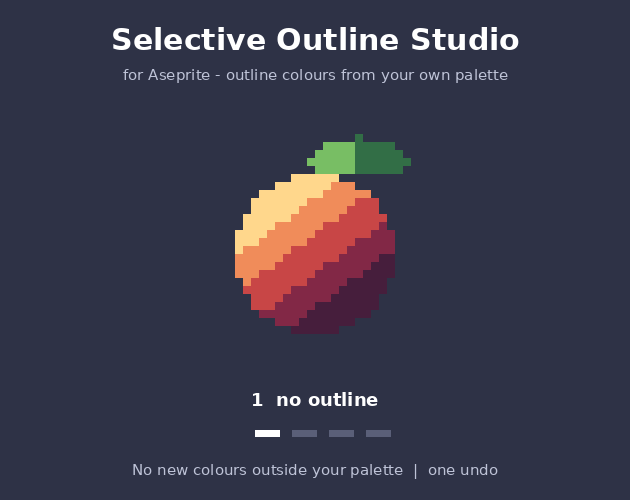

# Selective Outline Studio Lite (free) for Aseprite

Flat outer or inner 1 px outline in a colour of your choice, with pixel-perfect corner cleanup. Current frame only.

## Install
Double-click `selective-outline-studio-lite.aseprite-extension`. Aseprite 1.3+.

## Use
Right-click the cel > Properties > **Selective Outline Studio (Lite)...** or Edit > FX.

The full version adds **selective outline (sel-out)** with palette-locked colours and light direction, 8-neighbour
outlines and frame ranges: https://mst-9.itch.io/selective-outline-studio
**Disclosure:** the code was written with an AI coding assistant; no image AI is involved.

## Licence
MIT (this Lite version). The full version is a separate paid product.
